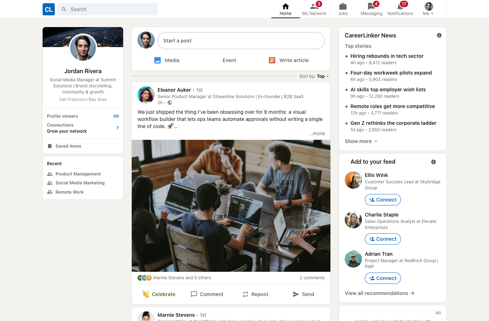
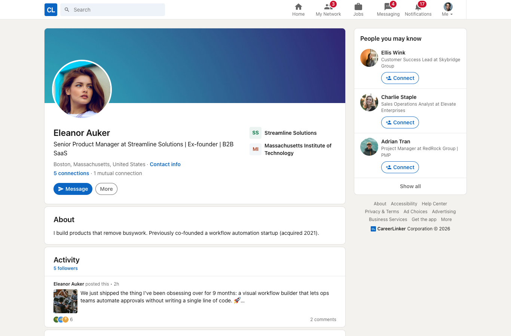
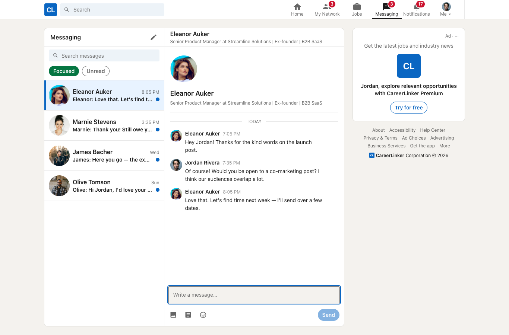
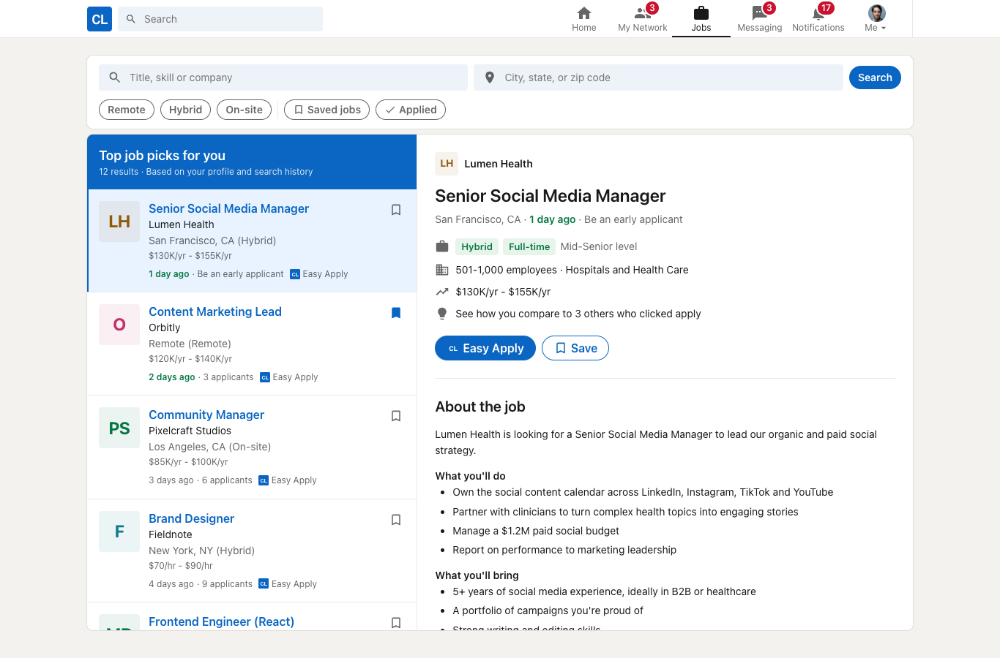
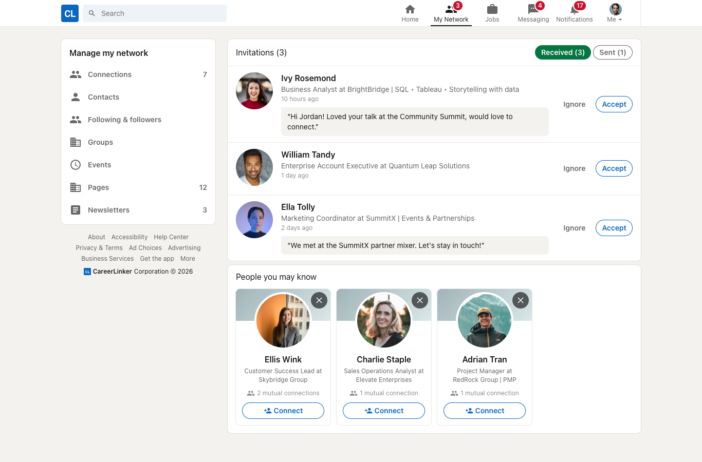

# CareerLinker

A LinkedIn-inspired professional network built with React and Flask.

**[Live demo](https://linkedling.onrender.com)**: click **Continue as demo user**, or sign in with `demo@careerlinker.io` / `password`.



## Features

- **Feed:** create posts with images, react with six reaction types, and comment
- **Profiles:** about, experience, education and skills, all editable
- **My Network:** send, accept and ignore connection requests; see people you may know
- **Messaging:** one-on-one conversations with unread indicators
- **Jobs:** search and filter, save jobs, and apply with Easy Apply
- **Notifications** and global **search** for people, posts and jobs

| Profile | Messaging |
| --- | --- |
|  |  |
| **Jobs** | **My Network** |
|  |  |

## Tech stack

- **Frontend:** React 18, Redux Toolkit Query, React Router, Vite
- **Backend:** Flask, SQLAlchemy, Flask-Login
- **Database:** PostgreSQL in production, SQLite locally
- **Hosting:** Render

## Run locally

Requires Python 3.11+ and Node 20+.

```bash
python3 -m venv .venv && source .venv/bin/activate
pip install -r requirements.txt
cp .env.example .env
flask db upgrade && flask seed all
flask run --port 5001
```

In a second terminal:

```bash
cd react-app && npm install && npm run dev
```

Then open http://localhost:3000.

## Contact

lingxi1023@gmail.com
